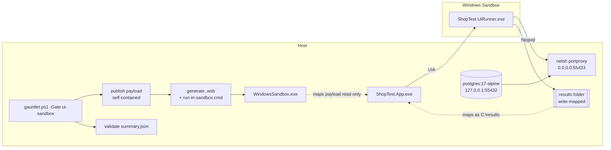

# UI tests in Windows Sandbox

The Windows-MCP UI pass needs the real desktop: it moves the pointer, types, and holds a control lease, so
the machine is unusable while it runs. The sandbox lane exists to remove that constraint.

Instead of driving the host desktop, the app and the scenario replay run **inside a disposable Windows
Sandbox VM**. The guest has its own display, mouse and keyboard, so injected input never reaches the host.
The host only starts the sandbox, waits for a result file, and reads the evidence.



## What runs where

| Step                                           | Host                 | Guest                        |
| ---------------------------------------------- | -------------------- | ---------------------------- |
| `dotnet publish` (self-contained app + runner) | yes                  | no SDK, no runtime installed |
| Start sandbox, generate `.wsb`                 | yes                  | -                            |
| Launch app, drive UI Automation                | -                    | yes                          |
| `sqlAssert` queries                            | -                    | yes, over the host bridge    |
| Screenshots and `results.json`                 | reads them           | writes to `C:\results`       |
| Verdict                                        | reads `summary.json` | writes it                    |

The payload is mapped **read-only**; only the results folder is writable. The guest is thrown away when the
run ends, so there is no leftover state between iterations.

## Prerequisites

1. Windows Pro/Enterprise/Education with virtualization enabled. Windows Sandbox is not supported on Home.
2. Enable the feature once, then reboot:

   ```powershell
   Enable-WindowsOptionalFeature -Online -FeatureName Containers-DisposableClientVM -All
   ```

3. A host-side bridge to PostgreSQL. Podman on Windows publishes ports on `127.0.0.1` only, which a guest
   VM cannot reach. `scripts\lib\sandbox.ps1` creates this when run elevated; otherwise it prints the exact
   commands:

   ```powershell
   netsh interface portproxy add v4tov4 listenaddress=0.0.0.0 listenport=55433 connectaddress=127.0.0.1 connectport=55432
   New-NetFirewallRule -DisplayName 'ShopTest sandbox DB bridge' -Direction Inbound -Action Allow -Protocol TCP -LocalPort 55433 -Profile Any
   ```

   The guest resolves the host through its default gateway, so no host IP is baked into the payload.

## Running it

```powershell
# whole loop, including the sandbox UI gate
powershell -NoProfile -ExecutionPolicy Bypass -File scripts\gauntlet.ps1 -Gate all -Iteration 4

# only the UI gate (database is recreated first, scenarios share it)
powershell -NoProfile -ExecutionPolicy Bypass -File scripts\gauntlet.ps1 -Gate ui-sandbox -Iteration 4

# deterministic gates only (use until the sandbox feature is enabled)
powershell -NoProfile -ExecutionPolicy Bypass -File scripts\gauntlet.ps1 -Gate all -Iteration 4 -NoUi
```

## The payload

`scripts\tools\publish-sandbox-payload.ps1` publishes `src\ShopTest.App` and `tests\ShopTest.UiRunner`
self-contained for `win-x64` into `artifacts\gauntlet\payload\` and copies the scenarios next to them. The
contract schema goes to a sibling `schema\` folder: the runner replays every `*.json` in the scenario
folder, so a schema document must never sit there. The result is cached behind a `.stamp` file and only
rebuilt when a source file, project file or scenario is newer; pass `-Force` to rebuild.

The gate then writes `run-in-sandbox.cmd` into the payload root. It resolves the host gateway, exports the
`SHOP_DB_*` variables, disables WPF hardware acceleration for stable capture, runs the scenario replay and
shuts the sandbox down.

## The runner

`tests\ShopTest.UiRunner` replays the same `ui-tests/scenarios/*.json` files the MCP pass uses. It is not a
sandbox-only tool: the same binary runs on the host, which makes it the cheapest way to check scenario
fidelity before involving a VM.

```powershell
tests\ShopTest.UiRunner\bin\Debug\net10.0-windows\ShopTest.UiRunner.exe `
  --scenarios ui-tests\scenarios --out artifacts\ui-runner --skip 00-notepad-smoke
```

Flags: `--app-exe`, `--run-id`, `--email`, `--name`, `--only`, `--skip`, `--timeout-scale`, `--fail-fast`,
`--sandbox`, `--list`. Exit codes: `0` green, `1` scenario failure, `2` infrastructure failure.

Behaviour worth knowing:

- Targets resolve in the same order as the MCP contract: `automationId`, then visible `text`. A
  `label`-only target (a Windows-MCP snapshot id) is rejected with a clear message instead of guessing.
- `{{runId}}` is derived per scenario (`<run-id>-s01`), so two scenarios in one iteration never register
  the same email or create identically named rows.
- `sqlAssert` polls until its timeout because persistence happens on the app's background thread. The
  expectation itself is never relaxed.
- `screenshot` steps are best-effort. If the guest surface returns blank pixels the step is recorded as
  `skipped` with reason `capture-unavailable` and the scenario continues: verdicts come from UIA state and
  SQL, not from pixels.
- `*.schema.json` files in the scenario folder are skipped instead of being parsed as scenarios; any other
  `*.json` without steps is still an error.

## Evidence

```
artifacts/gauntlet/iter-<n>/ui-sandbox/
  shop-sandbox.wsb           generated sandbox config (payload + results mappings)
  summary.json               run result, scenario list, durations, environment=sandbox
  _done.json                 completion marker the host waits for
  runner.log                 guest stdout/stderr
  guest-host.txt             gateway/port the guest resolved
  01-auth-register-login-<runId>/
    results.json             per-step status, duration, message, evidence reference
    step-25-auth-signed-in.png
    step-13-failure.png      only on failure
    step-13-failure.txt      UIA tree dump on failure
```

## Troubleshooting

| Symptom                                                     | Cause                                                              | Fix                                                                        |
| ----------------------------------------------------------- | ------------------------------------------------------------------ | -------------------------------------------------------------------------- |
| `Windows Sandbox is not available: ... feature is disabled` | optional feature off                                               | enable it and reboot                                                       |
| gate throws the `netsh` / `New-NetFirewallRule` guidance    | bridge missing, shell not elevated                                 | run the two commands in an administrator shell                             |
| sandbox starts, runner log shows Npgsql connect failures    | bridge points at the wrong port, or the container is not published | `Test-SandboxDbBridge`, then re-run the database gate                      |
| `Windows Sandbox exited before the runner wrote _done.json` | app failed to start, or the guest crashed                          | read `runner.log` and `guest-host.txt`; return codes are in `results.json` |
| gate reports `no summary.json` with an empty `runner.log`   | runner exited before producing output (bad flags, missing payload) | check the `run-in-sandbox.cmd` that was mapped into the guest             |
| `A Windows Sandbox instance is already running`             | single-instance limitation                                         | close the sandbox window and re-run                                        |
| screenshots missing, `skipped` steps                        | guest surface blank                                                | expected fallback; assertions still run                                    |

## Limits

- Windows Sandbox allows one instance at a time and its window size is not configurable, so the guest
  viewport is smaller than the 1920x1080 host desktop. The app's `FitToWorkArea` keeps the shell reachable;
  scenarios address elements by AutomationId rather than coordinates.
- No snapshots or persistence: every run boots a clean machine. That is the point for determinism, but it
  also means a cold start costs a few seconds per run.
- The sandbox is not a substitute for the in-process `ShopTest.UiTests` suite: those still cover bindings
  and the AutomationId contract in about a second.

## Choosing a UI check

| Check                                | Cost             | Desktop impact                   | What it proves                                         |
| ------------------------------------ | ---------------- | -------------------------------- | ------------------------------------------------------ |
| `dotnet test tests\ShopTest.UiTests` | ~1 s             | none                             | XAML loads, bindings, DI wiring, AutomationId contract |
| `ShopTest.UiRunner` on the host      | ~2 min           | takes over input while it runs   | full scenarios against the real app and DB             |
| `-Gate ui-sandbox`                   | ~3 min           | none (guest has its own desktop) | same scenarios, isolated and reproducible              |
| Windows-MCP scenarios                | minutes per step | lease on your desktop            | visual/interactive triage, one-off exploration         |
